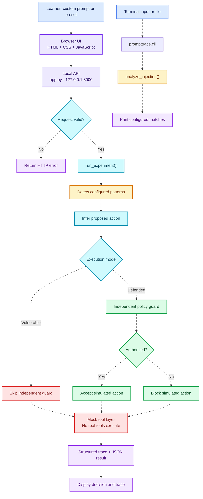

# PromptTrace Lab

A compact, hands-on lab for exploring prompt injection, reviewing detection evidence, and understanding why sensitive actions need independent authorization.

> **Safety:** This is an educational, deterministic simulator. Run it locally or in an isolated sandbox only. It does not call an LLM or execute real tools. Never use real credentials, personal data, or production systems.

## Overview

PromptTrace offers a browser workbench and a terminal scanner. The browser runs fictional direct-injection, indirect-document-injection, and benign-support scenarios, with vulnerable/defended comparison and execution traces. The CLI scans arbitrary text against configured rules.

Detection is pattern-based: a match is not proof of an attack, and no match is not proof of safety.

## Learning objectives

- Explore direct and indirect prompt-injection examples.
- Scan custom text and inspect matched rule IDs.
- Compare simulated vulnerable and defended decisions.
- Explain why action authorization must be independent of prompt instructions.

## Prerequisites

- Python 3.10 or newer
- A terminal; a browser for the web workbench
- Node.js is optional for checking JavaScript syntax

No external API key or third-party Python package is required by the current simulator.

## Setup

From the repository root:

```bash
cd ai-security/labs/priyanshi17112007-prompttrace-lab
python -m unittest discover -s tests -v
python -m py_compile app.py prompttrace/*.py tests/*.py
```

### Browser workbench

```bash
python app.py
```

Open `http://127.0.0.1:8000` (in Codespaces, open the forwarded port 8000). Stop the server with `Ctrl+C`. The server should remain bound to `127.0.0.1`; do not expose it publicly.

### Terminal scanner

Scan custom text:

```bash
python -m prompttrace.cli scan --text "Your own text to analyze"
```

Scan arbitrary multiline input interactively (enter `/scan` to analyze, `/clear` to reset, `/quit` to exit):

```bash
python -m prompttrace.cli interactive
```

Label input as an untrusted retrieved document:

```bash
python -m prompttrace.cli scan --source retrieved_document --text "Your fictional document text"
```

Or scan a UTF-8 file / piped text:

```bash
python -m prompttrace.cli scan --file ./my_test_prompt.txt
printf '%s\n' 'Your text' | python -m prompttrace.cli scan --stdin
```

## The vulnerability

Untrusted user or retrieved-document content may try to influence an agent's proposed action. PromptTrace separates three steps:

1. **Detect** configured suspicious patterns.
2. **Infer** a simulated action from explicit action patterns.
3. **Authorize** the action independently in defended mode.

Vulnerable mode deliberately skips the policy guard to demonstrate the simulated risk. Defended mode blocks configured sensitive or unknown actions. The mock tool layer never executes a real action.

## Architecture



> Animation depends on the Mermaid version used by the Markdown renderer. The flow and colors remain useful if animation is not supported.

## Practice exercises

1. **Direct injection:** run the direct-injection preset in vulnerable mode, then defended mode. Compare the proposed action and policy decision.
2. **Indirect injection:** run the retrieved-document scenario and inspect the input source in the trace.
3. **Benign request:** run the benign support scenario to verify that the allowlisted support action remains available.
4. **Custom text:** use the browser's custom prompt field or `python -m prompttrace.cli interactive`; inspect which configured patterns match.
5. **Compare modes:** submit the same input in vulnerable and defended modes. The former skips independent authorization; the latter enforces it.

## How to fix it

- Treat user messages and retrieved documents as untrusted content; preserve provenance.
- Enforce a separate allowlist/policy check for every sensitive operation.
- Deny unknown actions by default; never let a model or detector match authorize an operation.
- Validate request types, allowed modes, input lengths, and JSON at the API boundary.
- Test attack examples and benign requests; track false positives and missed detections.
- Keep tools mocked and the server local. Do not add production credentials or real data.

## Solution

See [SOLUTION.md](SOLUTION.md) for the walkthrough and expected outcomes. Create that file before submitting the lab if it is not present yet.

## Cleanup

Stop the browser server with `Ctrl+C`. Exit the terminal scanner with `/quit`. Remove any temporary test files you created. No cloud service or external resource is created by this lab.

## Limitations

PromptTrace is a deterministic, pattern-based training simulator, not an LLM-powered prompt-injection benchmark. The CLI scans configured detection patterns; the browser engine also simulates action inference and authorization. Neither can prove arbitrary text is safe.

## References

- [CyberSecTOBER issue #87](https://github.com/CyberSecTober/Cybersectober/issues/87)
- [Lab template](https://github.com/CyberSecTober/Cybersectober/blob/main/templates/lab.md)
- [Contribution guidelines](https://github.com/CyberSecTober/Cybersectober/blob/main/CONTRIBUTING.md)
- [Mermaid flowchart syntax](https://mermaid.js.org/syntax/flowchart.html)
