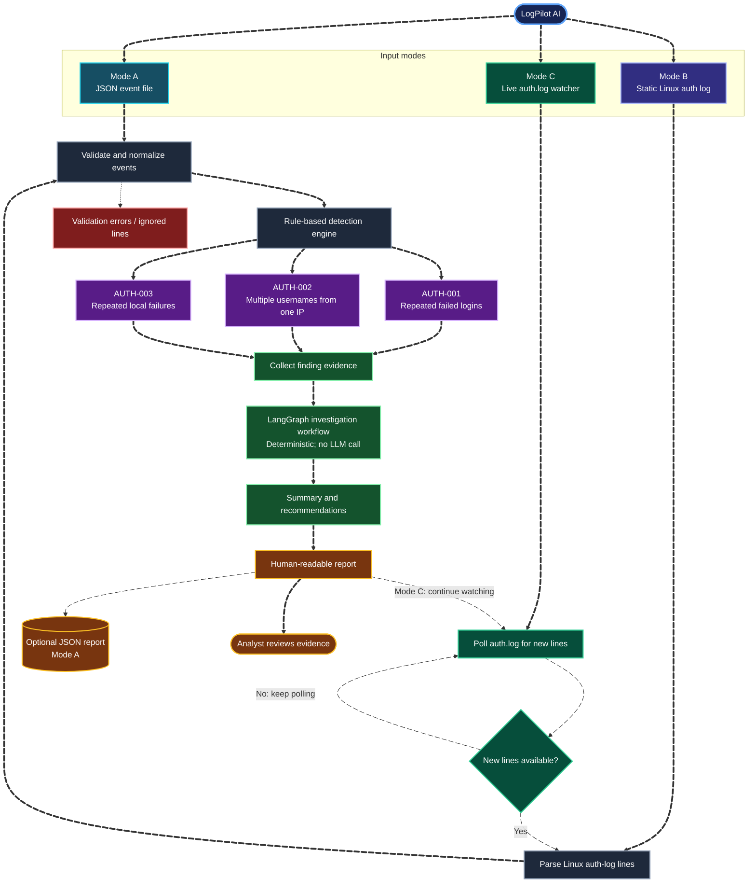

# LogPilot AI

LogPilot AI is a defensive security tool for analyzing authentication activity, identifying suspicious login patterns, and presenting evidence for an analyst to review. It supports three modes: JSON event analysis, static Linux authentication-log analysis, and continuous monitoring of a Linux authentication log file.

Detection is deterministic. LangGraph organizes the findings into an investigation workflow, but **the current workflow does not call an LLM**. LogPilot AI does not block IP addresses, change accounts, or automatically respond to security events.

## What it does

- **Mode A — JSON analysis:** validate and analyze authentication events from a JSON input file.
- **Mode B — Static auth-log analysis:** parse and analyze supported Linux authentication-log lines from a file.
- **Mode C — Live monitoring:** poll a Linux authentication log file for new lines, parse new events, and report newly detected findings.
- Detect repeated failed logins from one source IP (`AUTH-001`).
- Detect failed login activity involving multiple usernames from one source IP (`AUTH-002`).
- Detect repeated local authentication failures for a username (`AUTH-003`).
- Include rule IDs, severity, and supporting evidence in findings.
- Present a human-readable report and, in Mode A, optionally save a JSON report.
- Report validation errors for malformed or unsupported events where applicable.

These rules flag suspicious patterns; they do not prove that an attack occurred. Findings need to be checked against other available evidence.

### Detection rules

| Rule ID | Detection | Purpose |
| --- | --- | --- |
| `AUTH-001` | Repeated failed logins from one source IP within a configured time window | Helps identify brute-force-like activity. |
| `AUTH-002` | Failed logins involving multiple usernames from one source IP within a configured time window | Helps identify possible password spraying or username enumeration. |
| `AUTH-003` | Repeated local authentication failures for the same username | Flags repeated local/PAM authentication failures for review. |

## Data flow

The diagram shows the three input modes converging on detection and investigation. In Mode C, the watcher keeps polling; new lines enter the parsing pipeline, and the loop continues after each poll/report cycle. Animated edges require a Mermaid renderer that supports edge animation; if a viewer does not support it, the diagram should still show as a regular flowchart.



### LangGraph investigation workflow

1. **Collect evidence** — gathers relevant details from detector findings.
2. **Investigate evidence** — groups findings and records the triggered rules.
3. **Explain findings** — creates a cautious summary and recommendations from the available evidence.
4. **Build final report** — combines detection results with the investigation output.

The workflow organizes detected evidence; it does not independently verify that an attack occurred.

## Requirements

- Python 3
- Dependencies listed in `requirements.txt`
- Linux or WSL for Mode B/Mode C when reading Linux authentication logs such as `/var/log/auth.log`

Mode A can be used with the included synthetic JSON example. Access to system authentication logs may require elevated permissions. Only analyze systems and logs you are authorized to access.

## Installation

Clone the repository and move into this tool's directory:

```bash
git clone https://github.com/priyanshi17112007/Cybersectober.git
cd Cybersectober/ai-security/tools/priyanshi17112007-logpilot-ai
```

Create and activate a virtual environment:

```bash
python -m venv .venv
source .venv/bin/activate
```

On Windows PowerShell, activate it with:

```powershell
.venv\Scripts\Activate.ps1
```

Install dependencies:

```bash
python -m pip install -r requirements.txt
```

## Usage

### Mode A — Analyze JSON events

Analyze the included synthetic sample:

```bash
python logpilot.py --input examples/authentication.json
```

Save the report as JSON:

```bash
python logpilot.py --input examples/authentication.json --output report.json
```

Configure remote-login detection thresholds and the time window:

```bash
python logpilot.py \
  --input examples/authentication.json \
  --failed-threshold 5 \
  --username-threshold 3 \
  --window-minutes 10 \
  --output report.json
```

### Mode B — Analyze a static Linux authentication log

Parse a Linux authentication log file using the `authlog` format:

```bash
python logpilot.py --input /path/to/auth.log --format authlog
```

On Ubuntu/WSL, reading `/var/log/auth.log` may require elevated permissions:

```bash
sudo .venv/bin/python logpilot.py --input /var/log/auth.log --format authlog
```

### Mode C — Continuously monitor a Linux authentication log

Start watching `/var/log/auth.log` and process new lines as they are appended:

```bash
sudo .venv/bin/python watch_auth_log.py --input /var/log/auth.log --poll-interval 1
```

By default, live mode starts at the end of the file and watches for new entries. To process entries already present in the file at startup, add `--read-existing`:

```bash
sudo .venv/bin/python watch_auth_log.py \
  --input /var/log/auth.log \
  --poll-interval 1 \
  --read-existing
```

Press `Ctrl+C` to stop the monitor. The watcher handles new lines incrementally and includes safeguards for incomplete lines, duplicate lines, truncation, rotation, and temporary file errors. Availability of `/var/log/auth.log` depends on the Linux distribution and its logging configuration.

### Common command-line options

- `--input` — input JSON or log file path.
- `--output` — optional JSON report path for Mode A.
- `--format authlog` — parse the supported Linux authentication-log format in Mode B.
- `--failed-threshold` — failed-login count used by `AUTH-001`.
- `--username-threshold` — distinct-username count used by `AUTH-002`.
- `--window-minutes` — time window used for remote-login detection.
- `--poll-interval` — seconds between polling cycles in Mode C.
- `--read-existing` — process existing log lines when live monitoring starts.

Run `python logpilot.py --help` and `python watch_auth_log.py --help` to see the options supported by each command.

## Example output

The included sample JSON uses synthetic events and documentation-only IP addresses. A successful Mode A run should identify the two remote-login patterns represented in the sample. Exact wording and formatting can vary by version.

```text
LOGPILOT AI - Authentication Log Analysis
Events scanned: 6
Findings: 2

AUTH-001 - Repeated failed logins
AUTH-002 - Failed logins involving multiple usernames
```

In Mode C, the monitor first displays a startup message and then reports when it parses new events. An alert is emitted only when the configured detection logic identifies a finding; a single failed local authentication attempt is not expected to meet the repeated-failure threshold for `AUTH-003`.

## Running tests

From the tool directory, run the complete test suite:

```bash
python -m unittest discover -v
```

Check Python syntax:

```bash
python -m py_compile agent.py detector.py log_parser.py logpilot.py live_monitor.py watch_auth_log.py
```

The project test suite covers the CLI, event detection, log parsing, local authentication detection, and live-monitoring behavior. Run the tests in the environment where you plan to use the tool.

## How it works

1. The selected mode loads JSON events or reads Linux authentication-log lines.
2. Supported log lines are parsed and normalized into event records. Supporting `unix_chkpwd` lines are not counted as separate local authentication failures when the related PAM event is the event of interest.
3. The detector validates event data and applies the `AUTH-001`, `AUTH-002`, and `AUTH-003` rules.
4. The LangGraph workflow collects findings, groups evidence, and prepares a summary and recommendations.
5. The CLI prints the report; Mode A can also write a JSON report. Mode C continues polling for new log lines until interrupted.

## Limitations

- The supported log formats and fields are intentionally limited; other distributions or formats may need additional parser support.
- Threshold-based rules can produce false positives and false negatives.
- A source IP address does not establish a person's identity or intent.
- Findings depend on the quality and completeness of the input logs.
- Mode C monitors a file; it is not a system-wide event collector and may require a log path/configuration appropriate to the target distribution.
- The investigation workflow is deterministic and does not currently use an LLM or external service.
- No automatic blocking, account modification, or incident-response action is performed.
- Review findings and validate them against additional evidence before acting on them.

## Security and privacy

- Use only logs and systems you are authorized to analyze.
- Prefer synthetic or sanitized data for testing and sharing.
- Do not commit credentials, API keys, private logs, or sensitive personal information.
- Review generated reports before sharing them; reports may contain usernames, IP addresses, and other operational details.

## License

MIT — see [LICENSE](../../../LICENSE).
