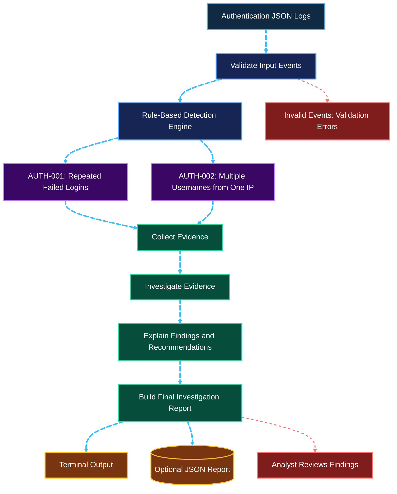

# LOGPILOT AI

LOGPILOT AI is a small defensive security tool that analyzes authentication logs, identifies suspicious login patterns, and produces an investigation report.

It combines deterministic detection rules with a LangGraph workflow to organize evidence, group findings by source IP, summarize observations, and suggest next steps for a security analyst.

The tool is designed for local analysis of JSON logs. It does not block IP addresses, modify accounts, or automatically respond to security events.

## What it does

- Detects repeated failed login attempts from a single source IP.
- Detects failed login activity involving multiple usernames from a single source IP.
- Records findings with rule IDs, severity, and supporting evidence.
- Groups findings by source IP for investigation.
- Generates a concise analyst summary and recommendations.
- Prints a human-readable report and can save a JSON report.
- Uses deterministic detection logic that does not require an LLM API key.

### Detection rules

| Rule ID | Detection | Purpose |
| --- | --- | --- |
| `AUTH-001` | Repeated failed logins from one source IP within a configured time window | Helps identify brute-force-like activity |
| `AUTH-002` | Failed logins involving multiple usernames from one source IP within a configured time window | Helps identify possible password spraying or username enumeration |

These rules identify suspicious patterns, not confirmed attacks. Analysts should validate findings against the surrounding context and other available telemetry.

## Workflow

The following diagram illustrates how LogPilot AI processes authentication logs, detects suspicious login activity, investigates findings using a deterministic LangGraph workflow, and generates a security report.



### LangGraph Investigation Nodes

1. **Collect Evidence** — extracts relevant fields from detector findings.
2. **Investigate Evidence** — groups findings by source IP and records triggered rules.
3. **Explain Findings** — produces a cautious summary and investigation recommendations.
4. **Build Final Report** — combines detector results with the investigation findings.

**Security note:** LogPilot AI uses deterministic analysis and workflow orchestration. It does not call an LLM, contact external services, or automatically block IP addresses or modify systems.

## Requirements

- Python
- Dependencies listed in `requirements.txt`

## Installation

Clone the repository and navigate to this tool's directory:

```bash
git clone https://github.com/priyanshi17112007/Cybersectober.git
cd Cybersectober/ai-security/tools/priyanshi17112007-logpilot-ai
```

Create and activate a virtual environment:

```bash
python -m venv .venv
source .venv/bin/activate
```

On Windows PowerShell, activate it with:

```powershell
.venv\Scripts\Activate.ps1
```

Install dependencies:

```bash
python -m pip install -r requirements.txt
```

## Usage

Analyze the included synthetic authentication logs:

```bash
python logpilot.py --input examples/authentication.json
```

Save the report as JSON:

```bash
python logpilot.py \
  --input examples/authentication.json \
  --output report.json
```

Configure the detection thresholds and time window:

```bash
python logpilot.py \
  --input examples/authentication.json \
  --failed-threshold 5 \
  --username-threshold 3 \
  --window-minutes 10 \
  --output report.json
```

- `--input` — path to a JSON file containing authentication events.
- `--output` — optional path for the JSON report.
- `--failed-threshold` — number of failed login events needed to trigger `AUTH-001`.
- `--username-threshold` — number of distinct usernames needed to trigger `AUTH-002`.
- `--window-minutes` — time window used for detection.

Run `python logpilot.py --help` to see the available command-line options.

## Example output

The included sample data is synthetic and uses documentation-only IP addresses.

A successful run should report two findings for the sample data:

```text
LOGPILOT AI - Authentication Log Analysis
Events scanned: 6
Findings: 2

AUTH-001 - Repeated failed logins
AUTH-002 - Failed logins involving multiple usernames
```

Exact formatting may vary by version. When the investigation workflow is integrated, the report also includes an analyst summary and recommendations.

## Running tests

From this directory, run:

```bash
python -m unittest discover -s tests -v
```

To check Python syntax:

```bash
python -m py_compile detector.py agent.py logpilot.py
```

## How it works

The detector validates and normalizes supported event fields, parses timestamps, validates source IP addresses, and applies configurable time-window rules to failed authentication events.

LangGraph coordinates the post-detection investigation stages. It organizes existing evidence and produces a report; it does not independently verify whether an attack occurred.

## Limitations

- The tool currently focuses on authentication events represented as JSON.
- Log formats from different platforms may require field mapping or preprocessing.
- Threshold-based rules can produce false positives and false negatives.
- A source IP address does not establish the identity or intent of a person.
- Detection results depend on the quality and completeness of the input logs.
- The current workflow does not use an LLM or perform automated response actions.
- Review findings and validate them with additional evidence before taking action.

## Security and privacy

- Use logs you are authorized to analyze.
- Prefer synthetic or sanitized logs when testing and sharing examples.
- Do not commit credentials, API keys, private logs, or sensitive personal information.
- Review generated reports before sharing them.

## License

MIT — see [LICENSE](../../../LICENSE).
